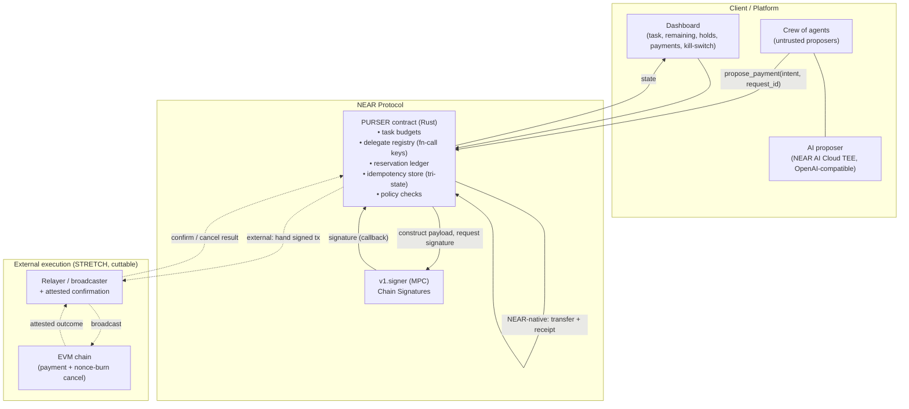

# Purser — Technical Design

> **One budget. Many agents. Nothing overspent.**

**Prepared:** 2026-10-27 · **Event:** NEAR HACKATHON (build window Nov 1–14, 2026)

---

## Tracks we apply to

Submission `tracks` array (every track Purser authentically fits; the build and all docs lead with `security`):

```json
"tracks": ["security", "swarms", "agents"]
```

| id | Track | How Purser fits |
|---|---|---|
| **`security`** (primary) | AI Security & Defense | The core product: spending limits, policy engine, scoped/revocable function-call keys, TEE-attested agents, failure-safe accounting. "Give AI money without giving it the keys." |
| `swarms` | AI Swarms | A crew of agents contends over **one shared budget** with intent-based reservation — literally *collective purchasing* and coordination between agents. |
| `agents` | Agent Economy | Agents earn the right to spend and pay for data/compute/APIs/services under governed authority. Agent commerce with a leash. |

> We do **not** list tracks we don't genuinely satisfy. Prizes are per-track and the submission is one entry, so these three are free, honest extra shots — but each surface (README, demo, submission `idea`) leads with the `security` framing so no track judge reads us as unfocused.

---

## 1. Design principles

1. **The AI is outside the trust boundary.** Every agent — LLM-driven or not — is untrusted. It may only *propose* payments. All safety is enforced by the deterministic contract. Consequence: **the security guarantee is a theorem about the contract, provable with tests, independent of model quality.**
2. **One invariant, enforced across failures.**
   > `completed + outstanding_authorized ≤ task_budget` — always, including under concurrency, timeouts, retries, and revocation.
3. **Reserve before you authorize.** Budget is decremented (reserved) *synchronously, before any async yield*, and signing happens only after the reservation is committed to state.
4. **Reclaim only on proof, never on silence.** A hold is released only when the outcome is positively known. A timed-out or unknown request stays reserved. Conservative accounting beats optimistic recovery we haven't implemented.
5. **Never blind-sign.** The contract constructs (or fully validates) the transaction payload it signs, so the policy layer always knows exactly what it authorized.
6. **Revocation is honest.** Revoking an agent blocks *new* authorizations; it cannot un-issue signatures already produced. We say so, in the UI and the docs.
7. **NEAR-native first; one external chain only after the core is provably correct.** A working NEAR-native mechanism beats an unenforced "multichain" architecture.

---

## 2. The invariant, formalized

Let the task budget be `B`. Each commitment `c` has a reserved amount `r(c)` and, once settled, an actual spent amount `s(c) ≤ r(c)`. Commitments occupy exactly one state (see §4). Define:

- `completed  = Σ s(c)` over `c` in `Confirmed`
- `outstanding = Σ r(c)` over `c` in `Reserved ∪ Signed ∪ Unknown`

**Safety invariant (I):** `completed + outstanding ≤ B` at every observable state of every task that is not **frozen** (a task is frozen only when the chain proves a wrong owner `reconcile`; it then authorizes nothing — see §4).

Every state transition is designed to preserve **(I)**:

- **Reserve:** admit a new commitment with amount `a` iff `completed + outstanding + a ≤ B`; then `outstanding += a`. (Atomic; see §5.)
- **Settle→Confirmed(s):** `outstanding -= r(c)`, `completed += s(c)`, with `s(c) ≤ r(c)`. Net change `≤ 0` → preserves **(I)**.
- **Fail-before-signature:** `outstanding -= r(c)` (safe release — no signature escaped). Preserves **(I)**.
- **Timeout/Unknown:** no change. The reservation persists. Preserves **(I)** by doing nothing.

**The entire security claim reduces to two mechanisms being correct:** (a) atomic *reserve-before-sign*, and (b) *tri-state idempotency* (§6). Everything else is bookkeeping. We harden and test those two hardest.

---

## 3. Architecture



### Components

| Component | Tech | Responsibility |
|---|---|---|
| **Purser contract** | Rust + `near-sdk` | Source of truth. Budgets, delegate registry, reservation ledger, idempotency store, policy checks, invariant enforcement. |
| **MPC signer** | `v1.signer` (Chain Signatures) | Produces signatures over payloads the contract constructs. Used for external-chain payments. |
| **Relayer / broadcaster** | Node service | Broadcasts signed external txs; reports **attested** outcomes back. Explicit, named trust assumption. *(Stretch tier.)* |
| **AI proposer** | NEAR AI Cloud (TEE, OpenAI-compatible API) | Generates useful purchase proposals. Untrusted; can run with attestation. |
| **Dashboard** | React + `near-api-js` | Live manifest, policy editor, kill-switch, reproducible-test runner. |

---

## 4. Reservation lifecycle (state machine)

```mermaid
stateDiagram-v2
    [*] --> Reserved: propose_payment()\n(atomic admit if invariant holds)
    Reserved --> Signed: payload constructed + MPC signature obtained
    Reserved --> Failed: rejected before any signature\n(policy fail / sign error pre-signature)
    Signed --> Confirmed: outcome proven\n(NEAR receipt, or relayer-attested)
    Signed --> Unknown: timeout / no proof
    Unknown --> Confirmed: later proof arrives
    Unknown --> Cancelled: nonce-burn cancel confirmed\n(external, stretch)
    Failed --> [*]: release reservation (safe)
    Confirmed --> [*]: reserved → completed (release over-reservation)
    Cancelled --> [*]: release reservation (safe)
    Unknown --> Unknown: stays reserved (no silent release)
    Failed --> Confirmed: late settlement proves a reconciled-as-failed\ntransfer landed (record spend; freeze task if over cap)
```



**Key rules:**
- `Reserved → Failed` is the **only** path that releases budget without an outcome, and it is reachable **only while no signature exists** (policy rejection, or MPC failure before a signature was produced).
- `Signed → Unknown` never auto-releases. The budget stays reserved until proof (`Confirmed`) or an explicit `Cancelled` (external nonce-burn, §7).
- NEAR-native payments reach `Confirmed` cheaply via the promise callback / receipt — no relayer needed.
- **Proof beats attestation (realized, PR #5).** NEAR does not bound receipt latency, so a settlement
  callback can land after an owner `reconcile` (which is time-locked by `RECONCILE_MIN_AGE_NS`, exposed
  via `get_config()`). The callback is total: agreement is a no-op; `Failed` + success takes the only edge
  out of a terminal state, `Failed → Confirmed`, recording the proven spend and emitting
  `reconcile_contradicted`; if that pushes `completed + outstanding` over the cap the task is **frozen**
  (refuses all new proposals); `Confirmed` + failure keeps the safe over-count and is flagged.

---

## 5. Concurrency: atomic reserve-before-sign

The invariant lives or dies here. On NEAR, requesting an MPC signature is a **cross-contract promise** — an async boundary. The danger: two concurrent `propose_payment` calls both pass the budget check *before* either reserves, and both proceed → overspend.

**Mechanism:**

1. `propose_payment` runs the admission check **and** writes the `Reserved` record **in the same synchronous execution, before any promise is created.** NEAR executes a single function call atomically up to its first `await`/promise; state is committed at that point.
2. Only after the reservation is durably in state do we create the signing promise.
3. The signing **callback** (`on_signed`) transitions `Reserved → Signed`; a signing *failure* callback transitions `Reserved → Failed` (safe release) **only** if it can prove no signature was produced.

```rust
// Pseudocode — the load-bearing path
pub fn propose_payment(&mut self, task: TaskId, intent: PaymentIntent, request_id: RequestId) -> Promise {
    self.assert_delegate_authorized(task, env::predecessor_account_id()); // fn-call key / registry
    // --- idempotency: synchronous, tri-state (see §6) ---
    match self.idempotency.get(&request_id) {
        Some(Committed { commitment_id }) => return self.replay(commitment_id), // replay → prior result
        Some(Pending)      => env::panic_str("in-flight"),    // retry while mid-sign
        Some(Failed)       => env::panic_str("already failed"),
        None => {}
    }
    // --- atomic admit + reserve, BEFORE any async yield ---
    let b = self.budget(task);
    require!(b.completed + b.outstanding + intent.amount <= b.cap, "exceeds task budget");
    let cid = self.open_reservation(task, &intent, intent.amount);     // outstanding += amount
    self.idempotency.insert(request_id, Pending);
    // --- only now: construct payload + request signature (async) ---
    let payload = self.build_payload(&intent);                         // §8 — never a client hash
    ext_signer::ext(self.signer.clone())
        .sign(payload, intent.key_derivation_path())
        .then(Self::ext(env::current_account_id()).on_signed(cid, request_id))
}
```

Everything that can break the invariant is in the synchronous prefix above. The demo's concurrency test (§9) must submit genuinely concurrent requests (same block / rapid-fire) so the race is actually exercised — otherwise the atomicity claim is untested.

---

## 6. Idempotency (tri-state, not a seen-set)

Keyed by client-supplied `request_id`. States: `Pending | Committed { commitment_id } | Failed`.

- The idempotency write happens in the **same atomic transition** as the reservation.
- A retry that arrives **while the first is still signing** sees `Pending` → returns "in-flight," never opens a second reservation. (The in-flight retry is the case naïve seen-sets miss.)
- On settlement, `Pending → Committed { commitment_id }`; on safe failure, `Pending → Failed`.
- Retries after settlement return the stored result — exactly-once authorization semantics.

---

## 7. External chain path (STRETCH — cuttable by Day 8)

NEAR-native is the core. The external path is attempted **only after** the core invariant is provably correct, and **removed from the core claim if not enforceable by Day 8.**

**If we build it, it's EVM — not Bitcoin.** Two reasons converge:
1. **Payload construction in-contract is most tractable on EVM** (RLP + keccak256 sighash, EIP-1559 fields). *Week-1 spike (Days 1–2): confirm RLP+keccak fits NEAR gas/size limits;* if not, external is cut immediately. **Spike done (2026-11-05): GO** — see `docs/EVM-SPIKE.md` (RLP + host keccak fits: +2.5 KB wasm, 0.023 Tgas per hash).
2. **Reclaim story is cleanest on EVM** via **nonce-burn cancellation.**

**The cross-chain reclaim problem & our honest answer:**
- A NEAR contract cannot read another chain's state, so a `Signed → Confirmed`/`Cancelled` transition for an external tx requires a **relayer/oracle to attest** the outcome. We name this trust assumption explicitly rather than hide it.
- A stuck external tx is resolved into "safe to release" by **nonce-burn**: sign a replacement tx at the *same nonce* (e.g., a 0-value self-send) with higher fee. Once the relayer attests the cancel landed, the original signature can never execute → the reservation moves `Unknown → Cancelled` and is released. EVM nonce ordering makes this clean; Bitcoin would require double-spending the same UTXO (messier).
- **Built and run on testnet (2026-11-06).** The signer interface was verified against near/mpc 3.18.0 and live views: `sign` takes a wrapped `request` (`payload_v2`, `path`, `domain_id` 0), 1 yoctoNEAR, at least 15 Tgas prepaid. Release is two-key: the relayer attests, but only the owner's `confirm_release` moves `Unknown -> Cancelled`. Every `sign` callback `Err` goes `Reserved -> Unknown`, never to released, because a signature may be public in a failed `respond`. See the root `README.md` ("EVM path (stretch)") for limits and evidence.
- Absent attested confirmation, external reservations **stay locked** (conservative accounting). We would rather lock budget than claim recovery we can't prove.

---

## 8. Payload construction (never blind-sign)

`propose_payment` takes a **structured `PaymentIntent`** `{ chain, recipient, amount, token, memo? }`, not a raw hash. The contract builds the canonical signing payload itself:

- **NEAR-native:** a `Transfer`/`FunctionCall` action to a validated recipient — trivial and fully introspectable.
- **EVM (stretch):** construct the EIP-1559 transaction (to, value, data, nonce, chainId, gas) → RLP encode → keccak256 → that digest is what goes to `v1.signer`. The contract therefore authorizes a *known* transaction, and policy (recipient allowlist, amount, chain) is checked against fields it constructed — not against an opaque hash it was handed.

This is what makes the policy layer *meaningful*: Purser can only enforce a policy over a transaction it understands.

**Realized (NEAR-native):** the contract records a per-spend, tamper-evident `payload_hash =
sha256( 32-byte domain || borsh(version, task, commitment_id, recipient, amount_yocto) )` on each
`Commitment` (built from the *validated* fields it also transfers, never a client hash; the pure core
builds the bytes, the `#[near]` layer hashes via `env::sha256_array`). The scheme is published by the
`payload_scheme()` view and the per-commitment `payload_version`, so an off-chain verifier re-derives
the anchor in any language without the Rust source. EVM (Prompt 12) fills the same field with its real
`keccak256(RLP(tx))` signing digest, selected by `intent.chain`.

---

## 9. Testing & evidence (this is the win)

Because safety is a contract property, we prove it reproducibly. Evidence, not adjectives.

**A. Property-based invariant tests** (`proptest` over the contract logic): generate random interleavings of `propose / settle / timeout / revoke / retry` operations across the crew and assert **(I)** never breaks and exactly-once authorization holds. This is the deterministic core proof.

**B. Attack regression suite** (fixed cases, `near-workspaces` integration tests on a sandbox) — one test per demo step:

| # | Attack / case | Expected |
|---|---|---|
| 1 | Three delegates, legit purchases | succeed, accounting correct |
| 2 | Concurrent requests exceeding remaining budget | excess authorization refused; **(I)** holds |
| 3 | Retry same `request_id` | no duplicate authorization |
| 4 | Retry while first is in-flight | returns "in-flight," no second reservation |
| 5 | Tampered recipient vs. constructed payload | rejected |
| 6 | Revoke a delegate, then new request | blocked |
| 7 | Timeout on a signed payment | reservation **retained**, not released |

**How the race is proven (realized, Prompt 6).** NEAR applies the receipts for one account one
after another, so "concurrent" means several `propose_payment` receipts execute while earlier
proposals' transfer → `on_near_settled` continuations are still pending. That is the window a
check-then-act design overspends in. The attack suite's race-driver fixture fans the proposals out
as one joined promise batch, which lands at Purser in a single block (coordinator tx at B →
drivers at B+2 → all proposals at B+3, in creation order). `race_proof` resolves every Purser
receipt to its block height and requires `max(admission height) < min(settlement height)`, plus a
single admission block on the driver path. Case 4 is a true in-flight retry by the same measure:
the retry executes before the first request's callback, and it sees `Pending` because the
idempotency write happens in the same synchronous step as the reserve. The `transact_async`
variants (2c/4b) are held to the same proof with a bounded retry that fails loudly.

**Case 7 mapping (honest).** On the NEAR-native path "signed" means *the transfer receipt was
issued*. The test-only `fault-injection` build kills the settlement callback after the transfer
executes. The commitment then reads `Reserved` (its state advances inside the lost callback), but
the accounting is the conservative one: the budget stays held through silence, retries and
revocation until the owner reconciles with proof, and `reconcile` is time-locked
(`RECONCILE_MIN_AGE_NS`) so it can never race a live callback. `Signed → Unknown` as a *state* is
proven by the pure-core property test and becomes reachable on-chain with the EVM relayer.

**C. Metrics harness** — *proposed metrics, measured on our harness, not claimed in advance*: budget overruns across concurrent runs (target 0), duplicate authorizations (target 0), valid requests wrongly blocked, added latency per authorization, cost (gas) per authorization, behavior under injected timeouts/retries.

**D. Honesty constraints (stated on screen in the demo):** the vulnerable baseline is an **explicitly labeled naïve implementation**; we never portray a simulation as a live exploit against a real competitor.

---

## 10. Tech stack

| Layer | Choice | Notes |
|---|---|---|
| Contract | **Rust + `near-sdk`** | Core enforcement; compiles to WASM. |
| Cross-chain signing | **Chain Signatures (MPC)** — testnet `v1.signer-prod.testnet` (mainnet `v1.signer`) | Signs contract-constructed payloads. |
| Confidential AI | **NEAR AI Cloud** (TEE, OpenAI-compatible API) | Proposer can run with attestation. |
| EVM encoding (stretch) | Rust RLP + keccak crates (gas-checked Day 1–2) | Only if the spike passes. |
| Integration tests | **`near-workspaces-rs`** (sandbox) | Attack suite, concurrency. |
| Property tests | **`proptest`** | Invariant over random op sequences. |
| Frontend | **React + `near-api-js`** | Dashboard, manifest, kill-switch, test runner. |
| Relayer (stretch) | Node service | Broadcast + attested confirmation. |
| Network | NEAR **testnet** | Public, verifiable tx references for judges. |

> ⚠️ **Do not use the Shade Agent Framework** — deprecated as standalone tooling since 2026-04-19. Build on NEAR AI Cloud / IronClaw / Chain Signatures directly.

---

## 11. Repository layout

```
purser/
├── contract/            # Rust near-sdk contract (the source of truth)
│   ├── src/
│   │   ├── lib.rs           # entrypoints: create_task, propose_payment, on_signed, revoke, settle
│   │   ├── budget.rs        # invariant (I), reserve/settle accounting
│   │   ├── reservation.rs   # lifecycle state machine (§4)
│   │   ├── idempotency.rs   # tri-state store (§6)
│   │   ├── delegates.rs     # fn-call-key registry, revocation
│   │   └── payload.rs       # payload construction/validation (§8)
│   └── tests/
│       ├── properties.rs    # proptest invariant (§9A)
│       └── attacks.rs       # near-workspaces attack suite (§9B)
├── proposer/            # AI proposer on NEAR AI Cloud (untrusted; TypeScript)
├── app/                 # React dashboard (near-api-js + wallet-selector)
├── indexer/             # TS event poller + thin Postgres/SQLite cache (derived, non-authoritative)
├── relayer/             # (stretch) broadcast + attested confirmation
├── scripts/
│   ├── deploy-testnet.sh    # create/fund accounts, build, deploy, init
│   ├── demo.sh              # one reproducible command → runs the 7 cases
│   └── metrics.sh           # measured evidence → docs/METRICS.md
├── docs/                # the Purser planning docs (+ EVM-SPIKE.md, METRICS.md)
└── README.md            # machine-readable, do-X-see-Y (§13)
```

---

## 12. Build schedule (two weeks, with gates)

| Period | Deliverable | Gate |
|---|---|---|
| **Days 1–2** | Threat model; minimal contract; **NEAR-native payment path working**; **EVM payload spike** (RLP+keccak within gas?) | If EVM spike fails → external path dropped from core now. |
| **Days 3–5** | Shared budgets, atomic reserve-before-sign, tri-state idempotency, revocation | Invariant holds in unit tests. |
| **Days 6–8** | Useful agent workflow (NEAR AI Cloud proposer); **one external (EVM) path** incl. nonce-burn + relayer attestation *if feasible* | **Day-8 cut gate:** external not enforceable → remove from core claim; ship NEAR-native. |
| **Days 9–11** | Concurrency / replay / mutation / timeout tests; property-based invariant suite; metrics harness | All 7 attack cases pass; metrics measured. |
| **Days 12–14** | Dashboard, docs, deployment verification, demo recording | Reproducible `demo.sh`; README done. |

---

## 13. README for judges (skeleton — do-X-see-Y)

> Written for a machine reader as well as a human. No marketing.

```
# Purser — on-chain spending controller for AI agent crews
Tracks: security (primary), swarms, agents

## What it is
A NEAR smart contract that lets multiple AI agents draw from one shared, capped
task budget and enforces: completed + outstanding_authorized ≤ budget — across
concurrency, retries, timeouts, and revocation.

## Try it (do X → see Y)
1. `./scripts/demo.sh`  → deploys to testnet, runs 3 agents on one budget.
2. Make legit purchases → see remaining budget decrease; tx refs printed.
3. Fire concurrent over-budget requests → see excess authorization REFUSED.
4. Retry a request_id → see NO duplicate authorization.
5. Tamper a recipient → see REJECTED (payload mismatch).
6. Revoke a delegate → see new requests BLOCKED.
7. Inject a timeout → see the reservation RETAINED (not released).
8. `cargo test` → property-based invariant + 7 attack cases, all green.

## Architecture
See PURSER-TECHNICAL.md §3. The AI is outside the trust boundary; safety is a
contract property, provable by the tests above.

## Honest limits
- Revocation blocks new authorizations; it cannot un-issue signatures already produced.
- Cross-chain confirmation relies on a named relayer attestation; absent proof,
  reservations stay locked (conservative accounting).
- MVP: one token, no USD oracle; NEAR-native core; one EVM path (if enabled).
```

---

## See also

- `PURSER-BUSINESS.md` — why/problem/solution/customer/positioning/business model.
- `NEAR-HACKATHON-STRATEGY.md` — track strategy and why this idea.
