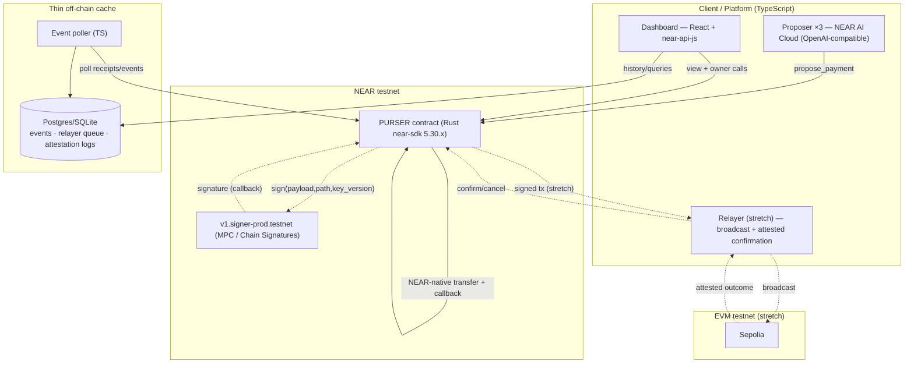

# Purser — Technical Requirements Document (TRD)

> **One budget. Many agents. Nothing overspent.**
> Status: v1 (hackathon) · Last updated: 2026-10-28 · Target: NEAR testnet

**Companion docs:** `PURSER-PRD.md` · `PURSER-BACKEND-SCHEMA.md` · `PURSER-APP-FLOW.md` · `PURSER-DESIGN-BRIEF.md` · `PURSER-IMPLEMENTATION-PLAN.md`. Deeper architecture rationale lives in `PURSER-TECHNICAL.md`.

> **Verification note.** Facts marked ✅ are verified against current primary sources (Oct 2026). Facts marked ⚠️ are **unverified in research and must be confirmed at build start** against the cited official source before coding. SDK versions move fast — pin and re-check.

---

## 1. System overview

Purser is a NEAR smart contract (source of truth) plus a React dashboard and TypeScript services — a proposer and an event poller, with a relayer in the stretch tier — and a thin off-chain cache:



---

## 2. Technology stack (pinned & flagged)

| Layer | Choice | Status | Notes |
|---|---|---|---|
| Contract | **Rust + near-sdk `5.30.x`** | ✅ 5.30.0 released 2026-10-27, targets nearcore 2.14 | Pin exactly; re-verify at build start (very fresh). |
| Contract macros | `#[near(contract_state)]`, `#[init]`, `#[private]`, `#[ext_contract]` | ✅ | Modern attribute-macro API. `propose_payment` is deliberately not `#[payable]` (S8). |
| Money/gas types | `NearToken`, `Gas` (`near-token ^0.3`, `near-gas ^0.3`) | ✅ | Used on all cross-contract calls. |
| Storage | `near_sdk::store::{IterableMap, LookupMap, Vector, IterableSet, LazyOption, …}` | ✅ | Prefer `IterableMap`/`IterableSet`; `UnorderedMap/Set` deprecated. |
| Cross-contract | `Promise::function_call(fn, args, amount: NearToken, gas: Gas)` + `#[private]` callback | ✅ | Callback via `Self::ext(env::current_account_id())`. |
| Fn-call keys | `Promise::add_access_key_allowance(pk, allowance: Allowance, receiver_id, function_names)` / `delete_key(pk)` | ✅ | `add_access_key` deprecated since 5.0.0. |
| Chain Signatures | signer **`v1.signer-prod.testnet`** (testnet), `v1.signer` (mainnet) | ✅ | MPC sign; see §6. |
| CS client lib | **chainsig.js** (`npm chainsig.js` ~1.1.16, repo `NearDeFi/chainsig.js`) | ✅ | `deriveAddressAndPublicKey`, `prepareTransactionForSigning`. `signet.js` may be successor ⚠️. |
| AI inference | **NEAR AI Cloud** (OpenAI-compatible), repo `nearai/cloud-api` | ⚠️ verify base URL/auth/models/attestation at docs.near.ai | Proposer is P1; contract works without it. |
| dApp SDK | **near-api-js** + **@near-wallet-selector** | ⚠️ verify current major version & React pattern | For dashboard connect + calls. |
| Services | **TypeScript** (proposer, relayer, scripts) | — | One language across off-chain. |
| Cache DB | **Postgres** (or SQLite for local) | — | Thin cache; see `PURSER-BACKEND-SCHEMA.md`. |
| Contract tests | **near-workspaces-rs** (sandbox) + **proptest** | ⚠️ verify current patterns | Attack suite + property tests. |
| EVM encoding (stretch) | RLP + keccak256 wasm crates (`rlp`/`tiny-keccak`/`alloy-*`) | ⚠️ feasibility spike Day 1–2 | See §9. |

> **Do NOT** use the Shade Agent Framework (deprecated as standalone tooling 2026-04-19). Build on near-sdk, Chain Signatures, and NEAR AI Cloud directly.

---

## 3. Core invariant (the contract's reason to exist)

At every observable state, with budget cap `B`:

> **completed + outstanding ≤ B**, where
> `completed = Σ actual_spent` over `Confirmed` commitments, and
> `outstanding = Σ reserved_amount` over `Reserved ∪ Signed ∪ Unknown` commitments.

Every state transition is designed to preserve it (full transition table in `PURSER-TECHNICAL.md` §2/§4). The whole security claim reduces to two mechanisms: **atomic reserve-before-sign** (§4) and **tri-state idempotency** (§5).

---

## 4. TR: Atomic reserve-before-sign (P0, load-bearing)

**Requirement:** the admission check and reservation write MUST complete **synchronously, before any Promise is created**. NEAR executes a function call atomically up to its first cross-contract Promise; committing the reservation before that boundary makes concurrent calls unable to both pass the check.

```rust
// near-sdk 5.30.x — verified idioms
#[near(contract_state)]
pub struct Purser { /* stores (see backend schema) */ }

#[near]
impl Purser {
    // Not #[payable] (S8): the runtime rejects any attached deposit.
    pub fn propose_payment(&mut self, task: TaskId, intent: PaymentIntent, request_id: RequestId) -> Promise {
        // 1) auth
        self.assert_delegate_authorized(&task, &env::predecessor_account_id());
        // 2) idempotency (tri-state) — synchronous
        match self.idempotency.get(&request_id) {
            Some(IdemState::Committed { commitment_id }) => return self.replay(commitment_id), // prior result
            Some(IdemState::Pending)      => env::panic_str("in-flight"),
            Some(IdemState::Failed)       => env::panic_str("already failed"),
            None => {}
        }
        // 3) validate + construct payload; allowlist check
        self.assert_allowlisted(&task, &intent.recipient);
        let payload = self.build_payload(&task, &intent);   // never a client hash
        // 4) ATOMIC ADMIT + RESERVE — must be before any Promise
        let b = self.budgets.get_mut(&task).expect("no task");
        require!(b.completed.0 + b.outstanding.0 + intent.amount.0 <= b.cap.0, "exceeds task budget");
        let cid = self.open_reservation(&task, &intent); // outstanding += amount; state=Reserved
        self.idempotency.insert(request_id.clone(), IdemState::Pending);
        // ---- NO ASYNC ABOVE THIS LINE ----
        // 5) execute (NEAR-native shown; EVM path = sign via v1.signer, see §6)
        Promise::new(intent.recipient.clone())
            .transfer(intent.amount)
            .then(Self::ext(env::current_account_id())
                .with_static_gas(Gas::from_tgas(10))
                .on_near_settled(cid, request_id))
    }

    #[private]
    pub fn on_near_settled(&mut self, cid: CommitmentId, request_id: RequestId) {
        match env::promise_result(0) {
            PromiseResult::Successful(_) => self.settle_confirmed(cid, request_id), // Reserved→Confirmed
            PromiseResult::Failed        => self.release_failed(cid, request_id),    // safe: no value moved
            // (ambiguity on NEAR-native is minimal; EVM uses Unknown — see §6)
        }
    }
}
```

**Acceptance:** a code comment marks the "no async above this line" boundary; a concurrency integration test proves exactly ⌊R/a⌋ of k genuinely-concurrent proposals succeed and the invariant holds.

---

## 5. TR: Tri-state idempotency (P0)

- Store keyed by `request_id`: `Pending | Committed { commitment_id } | Failed`.
- Written in the **same synchronous step** as the reservation.
- Retry while in-flight → return "in-flight" (panic or typed response), **no second reservation**.
- Retry after settlement → return stored result (exactly-once authorization).
- On safe failure → `Failed`.

**Acceptance:** attack cases (3) retry-after-complete and (4) retry-while-in-flight pass.

---

## 6. TR: Chain Signatures integration (stretch external path) ✅ interface

- **Signer contract:** `v1.signer-prod.testnet` (testnet). ✅
- **Sign call:** `sign(payload: [u8; 32], path: String, key_version: u32)` — payload is the 32-byte hash the contract constructs (never client-supplied). ✅ At the raw contract level a `domain_id` integer selects the curve (`0 = Secp256k1`, `1 = Ed25519`); the chainsig.js form uses `keyType: "Ecdsa"|"Eddsa"`. ✅
- **Response (ECDSA):** `{ big_r: 33-byte compressed SEC1 point, s: low-s Scalar, recovery_id: u8 }`. ✅ **Recovery alone proves nothing — the recovered key must be compared against the key the contract would have signed with.** ✅
- **Address derivation:** foreign-chain address = f(NEAR account id, path string, MPC master pubkey) via additive/epsilon derivation; secp256k1 → EVM/BTC, Ed25519 → Solana/etc. Deterministic (e.g. `example.near + ethereum-1` → a fixed `0x…` address). ✅
- **Client library:** chainsig.js (`deriveAddressAndPublicKey`, `prepareTransactionForSigning`). ✅
- **Gas/deposit:** attach adequate gas + the signer's required deposit — ⚠️ confirm exact values against `docs.near.org/chain-abstraction/chain-signatures/implementation` and chainsig.js at build start.
- **Caveat:** the response shape above is sourced from an in-development MPC PR; ⚠️ verify the deployed `v1.signer-prod.testnet` interface before relying on it.
- ✅ **Verified 2026-11-06** against near/mpc 3.18.0 source and live views (`docs/EVM-PROBES.md`). The deployed `sign` takes wrapped args `{"request":{"path","payload_v2":{"Ecdsa":"<64 hex>"},"domain_id":0}}` (not the positional form above), requires **1 yoctoNEAR** and at least **15 Tgas** prepaid (it reserves 7 Tgas for its own yield callback). The response is `{scheme, big_r.affine_point, s.scalar, recovery_id}`. The predecessor in key derivation is the Purser contract account. The call also ran live on testnet.
- **Failure semantics:** a callback `Err` is not proof that no signature exists (the MPC `respond` carries the signature in public args). Every post-reserve `Err` goes `Reserved -> Unknown`; budget is released only by the owner's `confirm_release` on attested evidence.

---

## 7. TR: NEAR AI Cloud proposer (P1) ⚠️

- Each proposer persona calls NEAR AI Cloud's OpenAI-compatible endpoint to produce a **structured `PaymentIntent`**, then calls `propose_payment`.
- ⚠️ Verify at `docs.near.ai` / `cloud.near.ai` (repo `nearai/cloud-api`): base URL, API-key header, available model ids, and the per-request **attestation token** retrieval + verification (Intel TDX / NVIDIA GPU TEE / Intel Trust Authority).
- Surface the attestation token in the dashboard as "proposer ran confidentially" evidence **if available**; otherwise document a TODO — never fake attestation.
- **Trust:** the proposer holds no authority beyond its delegate key; all limits are the contract's.

---

## 8. TR: dApp / dashboard (P0) ⚠️ version

- React + **near-api-js** + **@near-wallet-selector** (⚠️ verify current major version & modern React pattern at build start — recent breaking changes possible).
- View methods for the manifest (read-only, no key); owner change-methods (create_task, add/revoke delegate, set allowlist) via wallet; delegate actions via function-call key.
- Reads live state from the contract; reads history from the off-chain cache.

---

## 9. TR: EVM payload construction (stretch) ⚠️ spike-gated

- Construct an EIP-1559 transaction (to, value, data, nonce, chainId, gas) → RLP encode → keccak256 → 32-byte sighash, **inside the contract**, from the validated intent.
- ⚠️ Day 1–2 spike: confirm RLP + keccak256 crates compile to `wasm32` within gas/size limits (candidates: `rlp`, `tiny-keccak`, `alloy` primitives). Record wasm-size and gas numbers in `docs/EVM-SPIKE.md`; **GO/NO-GO gate**.
- ✅ **Spike result (2026-11-05): GO.** Hand-rolled RLP + the `env::keccak256` host function adds +2,462 B to the wasm (+0.99%), costs 0.0233 Tgas per hash, and taxes existing calls by ~0.003 Tgas; it matches 36 chainsig.js/viem vectors. Audited crates also fit (`rlp` +7.5 KB, `alloy-consensus` +12.7 KB). Construct-and-hash only: nonce/fee sourcing, the signature-recovery check, nonce-burn and `Chain::Evm` itself are not built. Numbers and reproduction (`make evm-spike`): `docs/EVM-SPIKE.md`.
- Reclaim via **nonce-burn**: replacement 0-value self-send at the same nonce, higher fee; released only when the relayer has attested the cancel **and the owner calls `confirm_release`** (two-key). Relayer is a **named trust assumption**.
- ✅ **Built 2026-11-06.** Nonce and fees are sourced from the contract lane and owner-set ceilings, validated before any digest is signed, and the signature is accepted only if it recovers to the cached derived key. The default wasm is no longer byte-identical to the spike era (353,741 bytes no-ABI, +42.6%). Limits (EOA recipients only, one in-flight payment per lane, single cancel, cap is value not gas): root `README.md`.

---

## 10. Security requirements

- **S1.** No entrypoint signs a client-supplied raw hash (grep-verified).
- **S2.** Owner-gated admin (`create_task`, `add_delegate`, `revoke_delegate`, `set_recipient_allowlist`, `remove_recipient_allowlist`, `reconcile`); delegate-gated `propose_payment`.
- **S3.** `#[private]` on all callbacks (predecessor == current account).
- **S4.** Reserve-before-sign boundary enforced and commented.
- **S5.** Conservative settlement: no release on silence; `Unknown` retains reservation.
- **S6.** Revocation deletes any issued function-call key and blocks new auth; documented that issued MPC signatures cannot be recalled.
- **S7.** No secrets in repo; keys via env; testnet only; never mainnet signing.
- **S8.** Storage-deposit / state-growth handled so a caller can't grief the contract. Realized: `propose_payment` is not `#[payable]` (the runtime rejects a deposit), request ids and memos are length-capped, and each task has a commitment limit counted on every commitment ever created (default 1000, owner-set via `set_task_limits`) plus an optional owner-set minimum payment for NEAR tasks; the limits live in a separate map under an appended storage prefix, so the contract state layout is unchanged.

---

## 11. Testing requirements

- **Property-based (proptest)** over the pure accounting/state machine: random op sequences assert invariant + exactly-once + no-release-on-silence after every step (thousands of cases). ⚠️ verify proptest usage patterns.
- **Attack suite (near-workspaces-rs)** — the 7 demo cases (see `PURSER-DEMO-SCRIPT.md`), incl. genuinely-concurrent dispatch for case 2 and in-flight retry for case 4. ⚠️ verify near-workspaces parallel-call pattern.
- **Metrics harness** — measured overruns (0), duplicate auths (0), wrongly-blocked, latency, gas, timeout/retry behavior → `docs/METRICS.md`.

---

## 12. Environments & config

- **Networks:** NEAR testnet (contract), Sepolia (EVM stretch).
- **Env vars** (`.env`, gitignored; `.env.example` tracked): `NEAR_NETWORK=testnet`, `PURSER_CONTRACT_ID`, `SIGNER_CONTRACT_ID=v1.signer-prod.testnet`, `NEAR_AI_CLOUD_BASE_URL`, `NEAR_AI_CLOUD_API_KEY`, `DATABASE_URL`, `EVM_RPC_URL` (stretch), `RELAYER_PRIVATE_KEY` (stretch).
- **Build/deploy:** `cargo near build` / wasm artifact; `scripts/deploy-testnet.sh`; `Makefile` targets `build/test/deploy-testnet/demo`.

---

## 13. Build-start verification checklist (do before coding)

- [ ] `near-sdk` latest stable is still `5.30.x`; pin exact patch.
- [ ] `v1.signer-prod.testnet` is live and its `sign` interface matches §6.
- [ ] NEAR AI Cloud base URL + auth + a working model id (docs.near.ai).
- [ ] near-api-js current major version + wallet-selector React pattern.
- [ ] near-workspaces-rs + proptest current APIs.
- [ ] (stretch) RLP/keccak wasm crate feasibility recorded.

---

## 14. Honest limits (state in README)

- Revocation blocks new authorizations; it **cannot** un-issue signatures already produced.
- Cross-chain confirmation relies on a **named relayer attestation**; absent proof, reservations stay locked.
- MVP: one token, no USD oracle; NEAR-native core; at most one EVM path.
- near-sdk 5.30.0 is very fresh; pinned and to be re-verified at build start.
